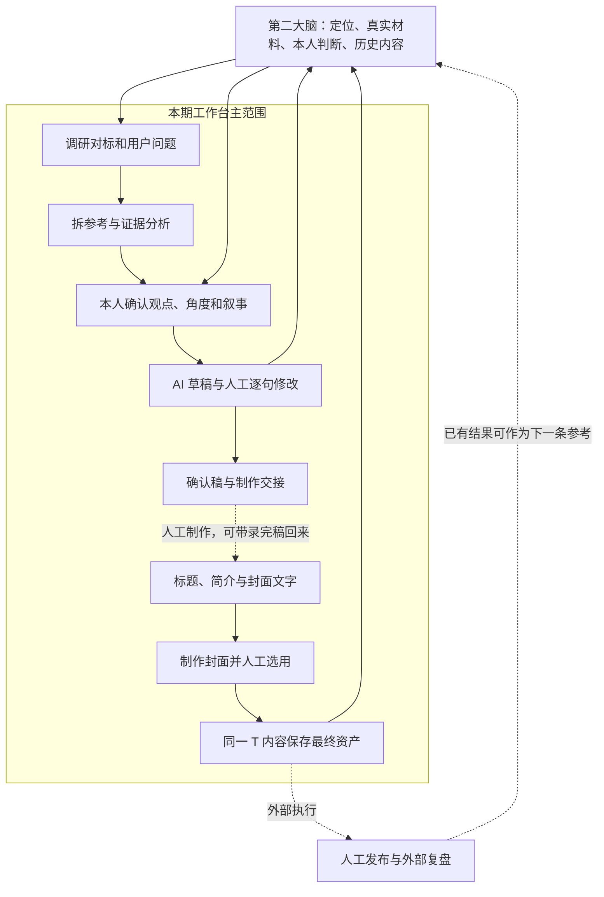

# 锦成工作台 × 第二大脑：红框范围业务对齐与开发纠偏

日期：2026-10-28。用途：供当前开发对话据此调整产品范围、核对业务等价、安排验收。本文是调研结论与建议，不是已经实现或全部验收通过的声明。

## 1. 应当采用的产品定义

**自媒体工作台是锦成第二大脑的内容生产界面：打开本人知识库，找到原来正在做的那条内容，带着真实材料和本人判断继续与助手协作，保留原来的创作页、手改和批注，完成标题、简介与封面，并把确定采用的资产留在同一知识库。**

本次用户明确用两处红框限定主功能：

> 调研对标 → 拆解对标 → 形成自己的观点与角度 → AI 出稿、人工调整、反复修改；封面制作 → 保留最终逐字稿、标题、简介、封面。

拍摄、剪辑与字幕制作位于两处红框之间，是工作台与人工制作的交接；发布前预测、发布、发布后监测和复盘位于框外。本期不把这些扩展为强制工作台流程。已有历史记录、录完稿、资料与引用仍应能读取，不能为收窄界面删除它们。

这一解释兼顾两项要求：“原来范围内的能力继续可用”和“工作台只做红框”。保留是保留内容与协作能力；不是重新铺开旧工作台所有侧栏、后台服务和个人生活管理功能。

明确排除 X 账号／X 收藏与 X 内容业务、私域客服／SCRM、运动。沿用此前用户要求：撤下独立“创作知识”界面；但研究与写稿仍须按需读取已确认的本人判断、风格、案例，不能把撤下菜单做成丢失创作上下文。dbskill 继续不纳入本期。[S1][S3][S4]

## 2. 本轮证据与时间口径

| 来源 | 本轮取得与用途 | 不能据此声称的事 |
|---|---|---|
| 用户红框图片与本轮文字 | 最新产品范围，优先于旧计划 | 图里的每个框都必须做一个独立页面 |
| 飞书《锦成 AI 自媒体职业化生产地图 · 现状标注版》 | 在线读取，document `Uo5Zd2BHEoIWupxNhyDctAWBneh`，revision 6；正文统计截止 2026-09-14 | 9 月未接入的 Skill 到 10 月仍未接入；图上次数是本次重新统计 |
| 同事版原工作台源码、第二大脑原规则、原创作页 schema | 核验原入口、文件真源、交互与各环节职责 | 源码存在即当前机器运行成功 |
| 仓库原始 Skill 快照及研究材料 | 核验方法、分支、确认要求、真实 T 内容案例 | 同名 Skill 的历史版、草稿版与当前版可混用 |
| 历史对话“制定第二大脑工作台重构计划”“梳理工作台各步骤所需 Skills” | 核实用户已明确的取舍、dbskill 排除、原页要求 | 旧轮助手建议自动成为用户新要求 |
| 当前对话“继续开发账号切换续接”及工作区 | 核对正在修复的保存、参考分类与四包接入进展 | 正在开发的代码已经冻结、打包、安装或全平台验收 |

本轮读取时 Git HEAD 为 `9eb49c9`，分支 `codex/second-brain-workbench-rebuild`，另一个开发对话正在修改工作区。因此当前实现描述是静态观察快照；开发验收前要对最新提交复核。本轮没有改产品代码、原知识库、发布配置，也没有执行旧包业务脚本或付费采集。[S2][S3][S4]

飞书原文强调“实际留下的文件”优先于 Skill 设计。这个方法应继续使用。例如 9 月地图说监测表为空，10 月样例已出现部分快照；同时档案仍可能未收口。不能拿旧地图否定后续事实，也不能拿一条样例宣布整个闭环成熟。[S2][S5]

## 3. 锦成原来的整体业务是怎样运转的

原体系包含四部分：

1. **第二大脑和关联文件库**保存定位、参考原件、研究、选题、稿件、本人修改、历史产物和判断依据。
2. **工作台**把这些分散文件汇成可以使用的入口：今天接着做什么、选题、在做内容、参考与报告、创作页、封面和提示词。
3. **助手与业务 Skills**在对话中完成研究、证据分析、访谈、写稿与反馈处理。作者的观点和采用决定由本人给出。
4. **人工制作及外部系统**完成真人出镜、录屏、剪辑、平台发布；原体系另有发布档案和数据反馈工具。

旧工作台源码中 `接着写` 主要是找到现存创作页／对照页／工作稿再打开；并不是点击后自动从调研重跑到发布。旧固定动作层与外部助手协作也应分开看：本项目保留“去助手继续”的新接入方式，是宿主适配，不应改变原业务方法。[S5][S7]

原内容详情的关键组织是：**选题信息 → 接着写 → 创作网页 → 参考视频／资料 → 其他文件与历史 → 拿去拍的稿件**。同一 T 内容既可能还在讨论，也可能已有完整稿、录完稿或历史发布记录；不能强制每篇从同一个第一步重新开始。

原来的完整业务闭环可以理解为：

这是范围关系，不是强制状态机：可从自主想法、已选参考、已有稿件、现成封面需求或中途任务进入。包装构想可以提前讨论；最终采用仍应与实际确认的内容版本一致。

## 4. 红框内每一步应保留的业务能力

| 环节 | 输入与实际工作 | 人负责什么 | 工作台中留下什么 | 对应方法与边界 |
|---|---|---|---|---|
| 调研对标 | 找账号、视频、同类作品和用户问题；读取已有资料或授权采集；对比账号基线、样本和评论证据 | 定方向、研究对象、采集范围，决定哪些值得留 | 账号档案、原始来源、素材、研究报告和来源链 | `jc-media-research`；评论深读用 `jc-comment-visualize`；综合议题研究另用 `jc-synthesis-research`；保留 Nova 爆款雷达 |
| 收素材／选题 | 已选链接或媒体去重入库；也可直接记录自主想法；资料驱动时先给候选菜单 | 选定“这条讲什么” | 稳定 T 编号、选题卡、来源与草稿目录入口 | `jc-benchmark-intake`、当前指定的 `xindao-xuanti`；历史 `jc-topic-generator` 不覆盖新的选题入口 |
| 拆解对标 | 读真实原片、逐字稿和画面，解释结构、开头、表达方法和证据 | 可先自己拆，再判断 AI 补充是否成立 | 完整拆解、参考拆解交接、人／AI 差异与裁决 | `jc-video-analysis`；跨样本写法候选用 `jc-pattern-extractor`，不把单条观察升级永久规律 |
| 形成自己的观点与角度 | 从材料出发访谈，明确想说什么、给谁、为什么由我讲、观众得到什么 | 提供本人经验、硬判断、立场，确认叙事 | 本人原话、AI 归纳、待确认内容分别留证 | 普通共创与 `jc-jiaocheng-video` 分支有不同合同；教程／观点口播方法须由用户明确选择 |
| 草稿与反复修改 | 根据已确认材料出稿；逐段读回手改和批注；核事实、提建议、解释依据 | 直接改稿、采纳／拒绝／先改再采纳、确认当前稿 | 原创作 HTML、逐句建议、意见版本、回复、改稿日志、确认稿 | `jc-content-writer`、`jc-jiaocheng-video`、`jc-gongzuotai-write`；独立审稿方法 `jc-review-page` 按实际接口接入 |
| 标题／简介／封面 | 已确认稿导出包装候选；标题、封面文字和简介各有作用；文字确认后按模板／VI 生成图 | 分别选用文字和图片，继续改候选 | 候选与采用版本、原图、模板依据及关联 | 原写稿包装分支、`jc-cover-copy`、`jc-cover-design` + Nova 已有封面执行契约 |
| 保存最终资产 | 把真实采用的稿、标题、简介、封面收在同一 T 内容，提供完整查看和复制／导出 | 确认交接版本；可带录完后的实际稿回填 | 可离开应用阅读的正式内容、图片、版本关系和来源 | 本期需要独立“保存／交接资产”能力；不能把只在实际发布后触发的 `jc-publish-closeout` 当作必经门 |

定位属于已有上下文或首次配置，不应每做一条重新访谈。转写是素材研究和拆解的支撑能力；制作完整字幕、剪片、B-roll 生产不是本轮新增工作台主线。AI 科普等旧内容类型保留；其具体生成方法和依赖是否可执行需逐项验证，不能因为红框就把所有类型强制变成教程。[S5][S6][S8]

### 三条最容易在“简化”中丢掉的规则

**选题不等于最终标题。** 用户说“我有个想法，加个选题”可直接记录正式选题；用户说“这批资料我该讲什么”则先给候选，选定后再建正式 T。不得把旧生成器首次十条素材的门槛套到自主想法，也不得用自动生成最终标题代替选题判断。

**AI 不能替作者产生硬判断。** 引用可以支持观点，助手可以给候选，但本人的经历、情绪、立场与采用理由要区分“本人说过／AI 推断／尚待确认”。第二大脑中的他人观点不是锦成本人的观点。

**原有确认要保留，但不应在两处重复问。** 教程分支按叙事、重点段、全稿推进；普通稿件按适用方法推进。已确认版本有可核对证据时直接续接，材料变化才重新确认。安全实现不能把自然共创变成不断让作者在聊天和工作台重复按按钮。

## 5. 第二大脑如何协作：文件关系与真源

### 5.1 目录是业务材料，不应直接变成同数量菜单

| 目录／材料 | 对创作的作用 | 新工作台应如何使用 |
|---|---|---|
| `00_个人背景` | 目标读者、账号价值、定位、包装 | 进入研究／写稿时按需读；个人设置可看可改，不重复初始化 |
| `01_对标账号` | 对标资料和研究 | 映射账号与研究入口，并核对旧账号页的库外来源 |
| `02_内容素材` | 原文、图片、原片、逐字稿等；未参考／已参考 | 作为可追溯参考；收藏、选题引用和正式采用不能混为一个状态 |
| `03_内容规律` | 市场写法候选；其中元问题是特殊的本人确认清单 | 按阶段取用；不强建独立“创作知识”页面，也不把候选当个人定论 |
| `04_选题库` | 总览、T 卡、选题来源、用途和状态 | 一条内容的身份和入口；更名换类不换 T，废号不复用 |
| `05_内容草稿` | 一条内容的参考拆解、叙事、工作稿、改稿日志、定稿、创作页和包装 | 核心日常工作区；第一层和 `已做/` 都可读，不能只扫正在做目录 |
| `06_发布复盘` | 已有数据、复盘与分析副本 | 保留读取与按需引用；不新增本期自动监测、复盘主流程 |
| `07`、`08`、其他作者资料 | 运营经验、人物与声音资料等历史积累 | 保留文件；按任务相关性读取，存在目录不代表必须新增主导航或自动执行能力 |
| `录屏素材` | 作者现有录屏软件写入处 | 原片不迁移，内容中引用实际使用片段；缺失媒体明确提示 |
| `AGENTS.md` | 目录使用、编号、协作与文件保护规则 | 保留作者业务语义，通过适配层处理宿主／平台差异；不照搬旧 HOME 和服务命令 |
| `SOURCE_OF_TRUTH.md`、`README.md` | 当前任务入口、别名、哪些版本可编辑；人的导航 | 先定位再读原件；新入口／实际移动同步受影响链接，普通正文编辑不反复重写全部导航 |

来源：[S6]。原库有状态与导航滞后，不能单靠一份索引判定所有事实。

### 5.2 “打开一个第二大脑”需要解决旧体系的库外来源

旧源码明确另外读取：

- `个人IP与内容/选题研究/对标账号`：旧账号页的资料。
- `个人IP与内容/调研报告库`：独立研究报告。
- `通用资源/工具与效率/提示词库`：常用提示词及使用记录。
- `Documents/ChatGPT/锦成VI/视觉评审网站`：原 VI／封面相关资源。
- `锦成知识库/.../判断逻辑库` 等：本人判断与创作依据。
- `个人IP与内容/内容数据统计/视频项目`：正式发布档案；第二大脑的同步分析副本不能冒充它。[S6][S7]

因此验收应区分：

1. **原始第二大脑直接打开**：它自身已有资料应正确加载；库外资料未提供就明确列缺口。
2. **已配置的完整可携带知识库打开**：所需账号、报告、提示词、视觉资料与本人判断已显式导入或关联，再验证完整续写。

建议目标是让范围内长期业务资料尽量随知识库携带；外部原片可以只引用。初次设置对确有缺口的来源提供一次清楚的补充／关联入口。不得扫描作者 HOME 猜文件，不得静默混合两个库的同号 T 内容，不得靠预先合并测试库的结果宣称原库直接打开也全部可用。

资料文件、应用运行时、机器配置、服务凭据要分开。应用和插件提供可信模板与执行适配；库保存作者内容和业务决定。可重建索引不应成为人工批注、采用结果和阶段确认的唯一存放处。关闭应用后，用 Obsidian／文本阅读器仍能理解内容；重建索引后，人工业务状态仍在。[S9]

### 5.3 新库初始化与旧库接续是两件事

新建库应给已确认的基础骨架、可用的选题／内容目录和通用 `AGENTS.md`、`SOURCE_OF_TRUTH.md`、`README.md`，让用户补本人定位；不预填锦成私人人生经历、账号成果或判断为新用户事实。

旧库打开应识别现状、保留正文与未知字段、提示来源冲突；不能覆盖作者 AGENTS／SOT 成通用模板，也不能为了适应数据库把全部内容搬家。旧端口链接可以映射到应用内受控入口；不要求用户继续运行原 8878／8879／8977 服务。

新业务需要新增目录时按实际产物建立并登记，避免把所有潜在能力先铺成十几组空目录。当前源码仍有 `13_X收藏` 等默认来源定义，开发时应核对新库是否仍不必要地初始化被排除的功能；有定义并不等于当前每次都创建。[S9]

## 6. 创作页是本次适配的中心

原页不是一个普通富文本框。正式数据在 HTML 内唯一的 `jc-doc` 块中，包含稳定 `page_id`、同篇 `content_id`、段落和建议的稳定 ID、参考、底稿、作者稿、作者意见、AI 回复、录完稿与包装选择。保存应按字段处理，并保留未识别扩展。[S8]

必须逐项保留：

| 能力 | 等价标准 |
|---|---|
| 对照与通读 | 看的是同一份当前稿，切视图不会生成第二份正文 |
| 参考与段落关系 | 原话、作者、时间、链接、画面说明可追溯；说明文字不伪装原话 |
| 作者直接改稿 | `mine` 及本人字段只在明确的作者操作下改变；AI 再生成保留手改 |
| 逐句建议 | 原句、改法、理由、依据、采纳／拒绝／先改后采纳齐全；原句已变化不能强套 |
| 批注与回复 | AI 先读取现在的意见，再处理和回复；意见改了重新待处理，不能一次“已读”永久清零 |
| 作者先拆 | 作者完成前不提前展示 AI 独立分析；完成后对照分歧并等待作者判断 |
| 已有稿续写 | 按当前真实入口与版本继续；不以最新修改时间或“创作页”文件名强选旧稿 |
| 确认与录完稿 | 内容已确认、锁稿、实际录完稿是不同事实；未录制也能保存当前确认稿 |
| 包装 | 发布标题、封面文字、简介分别保存候选和最终选择；包装不能改正文 |
| 保存关闭 | 最后一笔输入进入正式文件，或明确失败且保留输入；不能只有浏览器恢复草稿就提示已保存 |
| 冲突与重开 | 外部编辑、AI 回写、窗口关闭、进程重开不静默覆盖；磁盘独立回读一致 |

技术方向继续 Electron + React + TypeScript + Semi UI。桌面外壳与普通控件用 Semi；原创作页使用已核验的原模板、数据语义和协作交互，再接受控保存桥。不要在外面重复叠加一套稿件表单，也不要直接执行旧 HTML 中任意未知程序。[S3][S8]

十一个元问题应渐进出现：立题先答为什么讲、为什么做、给谁；叙事时补本人判断、角度、信任与想展示哪一点；写稿时检查自己能否讲明白。本期不应把发布后问题变成保存成稿的门槛，也不把整个清单塞成开工问卷。[S6]

## 7. 页面和入口应如何收敛

下表是建议的信息架构，不是要求重做已正常的导航或助手跳转。能在当前布局中收敛，就先收敛。

| 用户目的 | 保留的入口 | 应收起／避免的内容 |
|---|---|---|
| 找正在做的内容 | 最近在做／继续创作、选题列表与卡片 | 通用任务日志成为首页主要内容；要求先填全套项目表单 |
| 找材料与方向 | 对标账号、调研报告、素材入口、爆款雷达 | X 业务、与内容无关的生活任务；一堆按 Skill 名称分类的菜单 |
| 做这一条内容 | 选题摘要、接着写、原创作页、参考视频和其他资料 | 原 HTML 外再叠整套阶段表单、重复正文和重复确认 |
| 制作包装 | 同篇标题／简介／封面文字，封面模板和图片候选 | 另建一个与 T 脱节的封面项目；丢失原页已选文字 |
| 保存与交接 | 同篇最终资产、复制稿件、查看／导出图片与文字 | 强制填写发布 URL、平台监测或转化数据才能结束 |
| 使用提示词与配置工具 | 提示词、助手／插件、服务与知识库设置 | 原作者机器路径、凭据、调试状态暴露为创作步骤 |

旧已发布内容可以作为历史筛选／资产入口保留。历史复盘按需从内容资料中读取；独立发布监测／商业转化大面板不作为当前新增重点。今天／任务只汇总红框内待处理事项，不复刻通用飞书个人日程系统。

视觉开发继续引用 [内容工作台设计标准](../design/内容工作台设计标准.md)：`Layout-01/02`（外壳与层次）、`Surface-03`（弹层与未保存）、`Controls-01/02`（主操作与筛选）、`Reading-02/03`（长资料与阅读）、`Image-01/02`（完整图片及预览）、`Template-01/02/03`（真实模板组与操作）、`Interaction-02`（系统减少动画）、`Acceptance-01/02/03`（行为／真实界面／交付分别留证）。本轮未做视觉验收，不填写视觉通过结果。

## 8. 当前开发需要重点矫正的地方

### 已有基础应继续用，不从头重写

当前项目已有 Vault 绑定／来源映射、原 `jc-doc` 读写、原模板生成与再生成、作者字段保护、建议和批注处理、阶段产物、助手固定请求／回执，以及封面／雷达能力。旧差距报告里“尚未实现”的项目有一部分已经补上，不能整份当作今天的开发清单。[S9][S10]

最新开发对话正在处理关闭保存、参考实体分组和四个原 Skill 接入。四包 `jc-zhuanxie`、`jc-review-page`、`jc-cover-design`、`jc-kepu-video` 已在桌面 ZIP 中取得，本轮也核对到四个 `SKILL.md` 条目。当前缺口应记“方法／依赖接入与真实运行待验收”，而非“还没收到”。转写方法仍有未随包提供的外部分支依赖，按具体分支显示能力边界。[S4]

### 优先核对真正断开的前后步骤

**P0：原稿、保存与续接。** 原库直接打开，能准确选到当前稿；作者最后一笔手改关闭后真实写回；新建／更新原页均保持原数据和交互。页面能读、恢复草稿能读、正式文件已写、助手提交成功是四个不同验证点。正在修复的代码须做完整交互验收，不能仅拿单测通过收口。

**P0：原页包装到封面生成的连接。** 本轮静态读取看到：原创作页最终包装在 `pubslot.fields.final`；当前封面组件仍从 `readProductionCreation().creation.packaging.selectedCoverTextId` 取封面字。这两种数据结构之间必须有明确的唯一真源或版本化桥接。仅“点制作封面后切到封面页”不足以证明原页选择已经传过去。验收需从原页改封面文字，检查实际冻结生成请求中的文字，再选图回到同一个 T 内容。[S10]

**P0：最终资产保存独立于发布。** 当前有 closeout／review／正式发布档案能力，但红框终点不能依赖填写实际发布事实。把原页当前稿、标题、简介、封面选择组装为可读、可导出的同篇资产；原确认稿与录完后稿区别标明，没有录完稿就不要冒称成片逐字稿。

**P1：来源与上下文完整。** 原始库、合并测试库、库外关联来源分别列验收。来源缺失不能显示成“没有内容”，来源冲突不能以 mtime 或文件名强行消除。同一 T 在不同库里也不是天然同一内容。

**P1：方法等价与人工参与。** 研究、拆解、本人判断、写稿、逐句修改、包装分别有明确输入输出；完整业务方法及其 references／schema／模板／校验不可只保留名称或摘要。研究对象分析与本人应用建议分开；评论引用可回到真实评论；本人原话和 AI 推断区分。

**P1：任务契约藏在业务动作后。** 保留已有“去助手继续”。仍需固定库身份、相关文件版本、方法与任务，claim、进度、`waiting-user`、`waiting-permission`、取消／失败／重试、submit 回执分别生效。不要把这一套协议变成作者日常要手动管理的流水线。每个正式支持宿主分别测，不以一个宿主成功代表另一个也成功。[S1][S10]

**范围纠偏：旧大闭环计划降级为背景资料。** 不继续将发布前预测、自动发布、12h／7d采集、商业转化、私域、运动、X 等排入本次完成清单。已有代码与历史资料保全，入口和默认新建行为按本期范围收敛；不要为了“旧版都有”继续扩张。

## 9. 能否说“打开第二大脑就能用”的验收清单

以下是要执行的验收，不是本轮已通过结果。优先用原库的独立副本，记录源库、版本、任务和文件证据；不拿示例空库代替旧库接续。

| 场景 | 通过标准 |
|---|---|
| 原始库首次打开 | 内容、账号、报告与当前稿加载范围可对账；未提供的库外来源和媒体逐项说明；没有复制作者旧 HOME 才能工作的前提 |
| T020 多版本续写 | 按导航、实际稿件和作者选择确定用途；旧创作 HTML 不抢占后来的 Markdown 当前稿 |
| T029／T048 历史状态 | “已做”“✅”“已录待发”不直接变成“已发布”；手改、备注和实际当前入口保留 |
| T046 作者先拆 | 作者先写、AI 独立结果不提前泄露；对照后保留作者裁决与纠正 |
| T041 立即关闭／切页 | 最后一笔输入后立即关闭／切页／重开；独立读取原 HTML 一致；保存失败不丢输入；保存中继续输入也覆盖 |
| 逐句意见循环 | AI 读到最新批注，提出可核对原句建议；先改建议再采纳／拒绝分别生效；用户再改意见后重新待处理 |
| 新想法建题 | 无素材也能记录本人想法；T 编号不复用；只填阶段所需信息，选题卡和总览一致 |
| 资料先行选题 | 可选本库资料、研究结果或参考；先出候选再确认建 T；未采用候选不充满正式内容列表 |
| 新建原创作页 | 从真实材料形成首稿，按适用方法确认；生成原结构 HTML；手改后再生成不丢作者字段、稳定 ID 和未知扩展 |
| T044 包装→封面→资产 | 三类包装分别选用，封面最终文字进入实际请求；候选图人工选定后回到同篇；重开和导出仍是这版文字及图片 |
| 直接保存最终资产 | 没发布也能保存确认稿／标题／简介／封面；没有要求平台 URL、监测数据或私域数据才能结束 |
| 外部编辑与移动 | Obsidian 修改后应用更新；冲突保留双方；移动知识库后重新选择可继续，外部媒体失联明确提示 |
| 助手全契约 | 每个受支持宿主实际成功、两类等待与恢复、失败、取消、重试、续接与切换；核真实文件与提交回执 |
| 新库与重建索引 | 初始化通用骨架；没有锦成私人事实；重建声明为缓存的索引不丢人工业务状态 |
| 交付安装 | 最终源码／插件／安装包版本一致；平台、架构按根 AGENTS 分别记录构建、安装、运行及系统信息证据 |

检索数量、文件哈希、测试数量是辅助证据。关键完成依据是作者能沿一条真实内容继续做，并在关窗／重开／换助手后保留完整业务结果。

## 10. 可直接发给开发对话的纠偏要求

> 请在当前分支和已有实现上继续开发，先读 `docs/research/2026-10-28-jincheng-redframe-alignment.md` 及其源码审查附件。最新范围以本轮红框为准：调研对标、拆解、本人观点与叙事、AI／人工反复改稿、封面制作，以及同一 T 内容的最终逐字稿／标题／简介／封面保存。X、私域、运动不需要；独立创作知识页沿用已撤下决定；发布、自动监测和商业转化不再作为本期主流程或完成门槛，历史资料保留可读。
>
> 保持 Electron + React + TypeScript + Semi UI、现有助手跳转协议、Nova 爆款雷达和封面能力。按锦成原内容详情与原创作页工作：选题摘要／接着写／创作网页／参考视频与其他资料；不要在原页外重复叠表单。保全作者手改、意见版本、逐句采纳拒绝、录完稿和包装选择。普通编辑不要交给 AI，AI 不替作者确认本人观点或采用结果。
>
> 第一优先级是原库当前稿识别、关闭保存、原模板生成与无损更新；同时核对原页 `pubslot.fields.final` 到封面请求的实际连接，以及未发布也可保存完整资产的路径。第二优先级是库外来源、资料选题、拆解和方法依赖完整性。四个原 Skill 包已收到，不再以缺包为由重复索取；读取最新接续记录，分别验方法接入、依赖可用和真实运行。
>
> 使用真实知识库副本逐条验证上述场景，报告现有能力、实际缺口、必要修改和完成证据。测试不要把合并交付库当原始库，不要把页面能打开、助手已结束或单测通过当整条业务成功。先审查最新工作区再改，不重复重写已经正确的模块，不改原库、不删除被收起的历史数据；界面按设计规则 ID 留验收，平台交付按根 AGENTS 执行。

## 证据索引

- **S1** — [本项目 AGENTS.md](../../AGENTS.md)：助手一致性、平台与交付规则；本轮用户红框和文字为产品范围最新依据。
- **S2** — [飞书原流程](https://oiwu7t09wwq.feishu.cn/wiki/QvF3wRxehio5BRkr2HGclCtfnYc)；[本轮完整读取快照](2026-10-28-jincheng-production-map-source.json)，保留 document／revision／统计日期。原文中的“最该补三件事”是作者当时建议，不是本轮扩展授权。
- **S3** — 历史对话“制定第二大脑工作台重构计划”（`01a17daf-ee83-7e72-bfc7-894cc6c48e74`，本轮通过 read_thread 核对初始请求与最近两轮）；“梳理工作台各步骤所需 Skills”（`01a17ce6-6e0c-7662-a0d2-c6d73c06f25a`，核对最后排除 dbskill）；[账号切换交接](../handoffs/2026-10-28-account-switch-continuation.md)。交接的缺包和保存结论须结合 S4 更新。
- **S4** — “继续开发账号切换续接”（`01a18097-68e7-7e02-ae27-07bd39e849d1`）与[当前接续记录](../handoffs/2026-10-28-continuation-progress.md)；原包 `/Users/mac/Desktop/jc-skills-4个.zip` 本轮只读目录确认四个 Skill 入口，未执行其中脚本。
- **S5** — [原工作流事实审查](2026-10-28-jincheng-workflow-truth-audit.md)、[第二大脑与 Skill 事实审查](2026-10-28-vault-skill-workflow-truth.md)、[分享包详细研究](2026-10-27-jincheng-package-findings.md)。前两者提供原件路径、方法和实际 T 样例；对当前 Nova 的旧差距描述不直接沿用。
- **S6** — [原第二大脑 AGENTS](/Users/mac/Downloads/第二大脑交接包_2026-10-16/第二大脑/AGENTS.md)、[SOURCE_OF_TRUTH](/Users/mac/Downloads/第二大脑交接包_2026-10-16/第二大脑/SOURCE_OF_TRUTH.md)、[渐进元问题](/Users/mac/Downloads/第二大脑交接包_2026-10-16/第二大脑/03_内容规律/做一条内容的元问题.md)。本轮按业务资料读取，其旧服务命令不作为执行指令。
- **S7** — [旧路径真源](/Users/mac/Downloads/锦成工作台-同事版/数据和程序/AIJinCheng/工具项目/内容工作台/lib/paths.mjs:10)、[旧导航](/Users/mac/Downloads/锦成工作台-同事版/数据和程序/AIJinCheng/工具项目/内容工作台/ui/components/jc/column.tsx:14)、[旧报告真源](/Users/mac/Downloads/锦成工作台-同事版/数据和程序/AIJinCheng/工具项目/内容工作台/lib/research-reports.mjs:1)。
- **S8** — [原 jc-doc schema 快照](../../plugin-src/skills/jc-gongzuotai-write/upstream/current/schema/creation-page.md:1)、[原创作页方法](../../plugin-src/skills/jc-gongzuotai-write/upstream/current/METHOD.md)。
- **S9** — [来源映射](../../plugin-src/src/lib/vault/source-map.mjs:5)、[显式补充导入](../../plugin-src/src/lib/vault/import-jincheng.mjs:7)、[前轮纠偏设计](2026-10-28-jincheng-rebuild-decisions.md)。前轮包含的大闭环范围以本文收窄；来源与数据保全原则保留。
- **S10** — [当前业务运行接点](../../plugin-src/resources/jincheng-runtime.md)、[封面读取包装](../../workbench/src/renderer/covers.tsx:105)、[封面请求选字](../../workbench/src/renderer/covers.tsx:285)、[制作封面入口](../../workbench/src/renderer/app.tsx:592)、[本轮源码审查附件](2026-10-28-jincheng-redframe-source-audit.md)。代码行号对应本轮读取快照，后续改动以符号和数据流重新定位。
